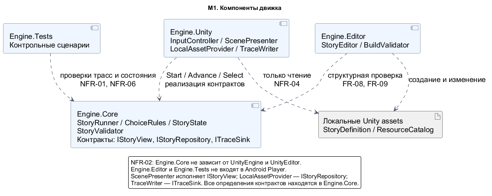
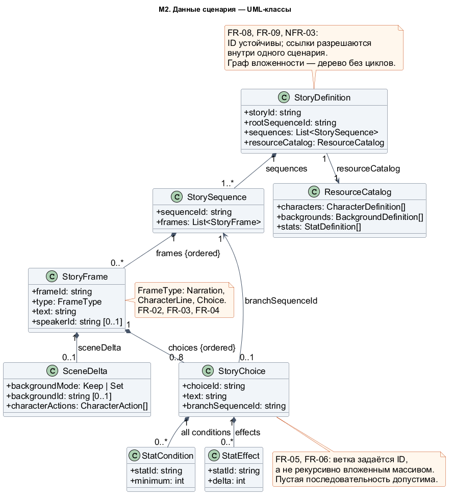
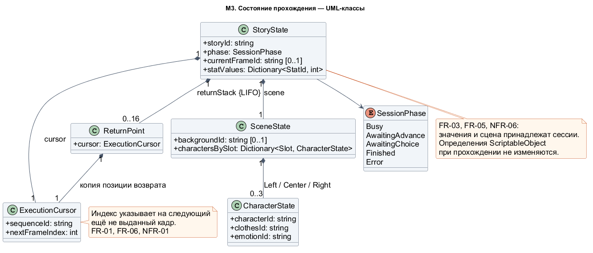
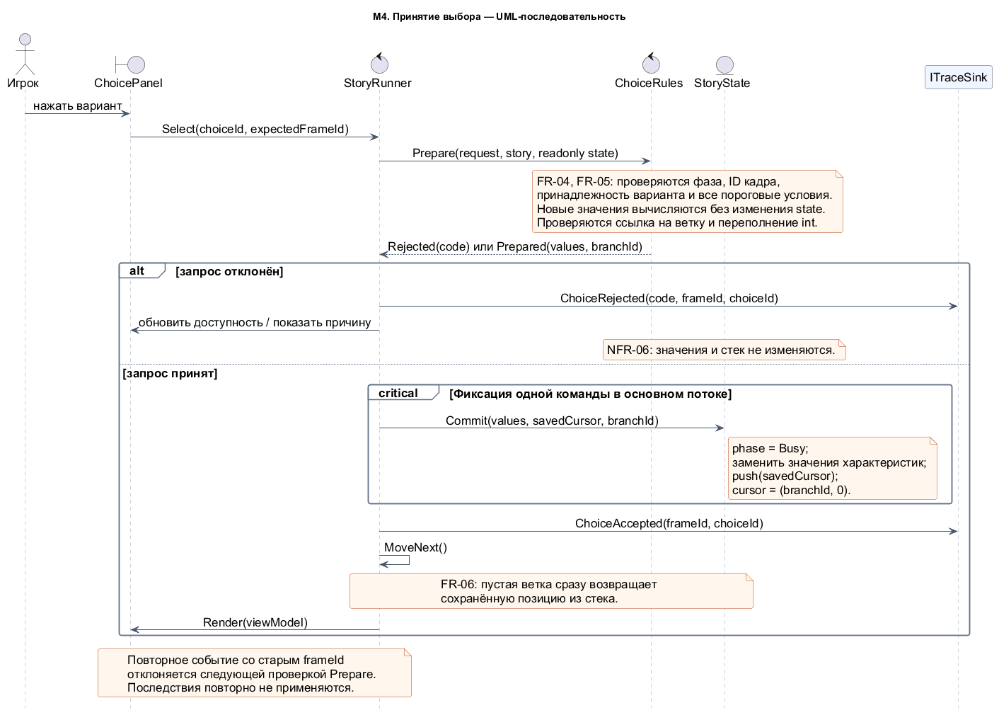
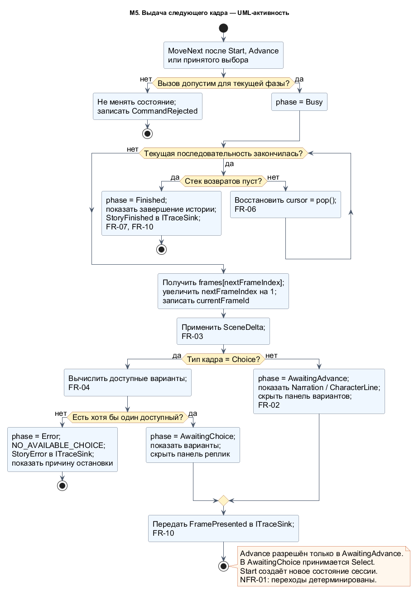
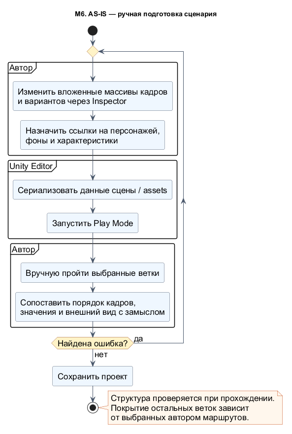
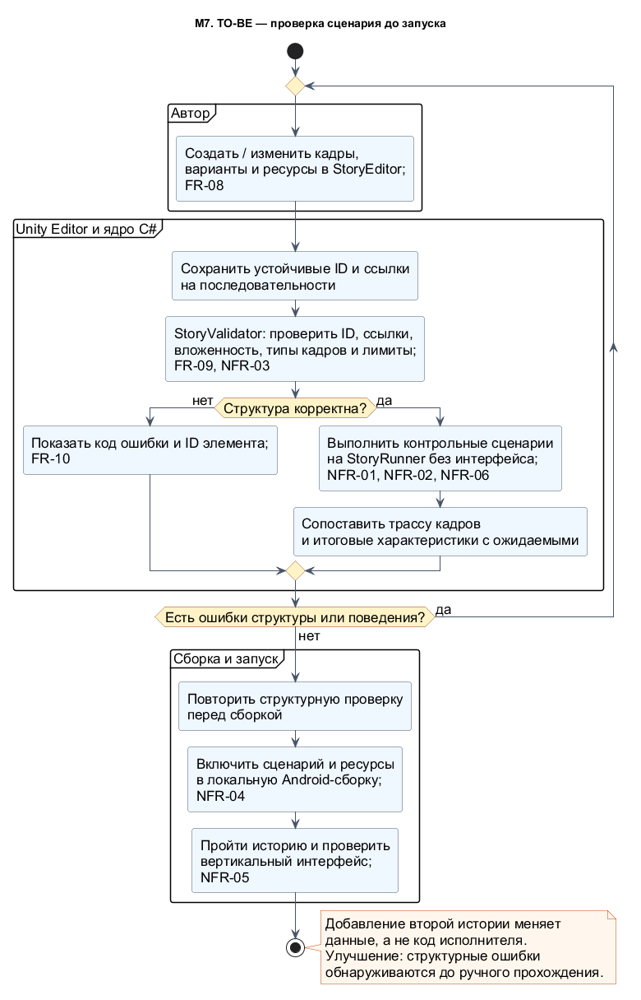

# ЛР 3 — проектирование

**Тема ВКР:** Разработка движка для интерактивных визуальных историй с поддержкой ветвящегося повествования.

**Автор:** Катков Алексей Сергеевич, Университет ИТМО, группа K3339, GitHub: [Deraxus](https://github.com/Deraxus).

**Формат работы:** индивидуальный проект.

## 1. Предметная область и требования

### 1.1. Описание предметной области

Движок исполняет интерактивные визуальные истории, содержащие текстовые кадры, реплики персонажей, изменения сцены и варианты выбора. Выбор может открывать вложенную последовательность кадров и изменять характеристики. После завершения ветки исполнение должно продолжаться с нужного места родительской последовательности.

Автор истории подготавливает сценарные данные и назначает ресурсы в Unity Editor. Игрок читает историю, переходит к следующему кадру и выбирает доступные действия. Разработчик движка поддерживает общие механизмы исполнения и проверяет их на контрольных сценариях. ECLIPTIC используется как демонстрационная игра; программная основа рассчитана на подключение других историй.

Система работает локально в составе Unity-приложения. Сервер и реляционная база данных не требуются: определения сценариев сохраняются в Unity assets, а состояние прохождения существует отдельно в памяти. В объём проектирования входят подготовка и проверка данных, исполнитель, система характеристик, представление сцены и диагностика. Сохранения между запусками, внешняя публикационная платформа и автоматическая генерация сюжета в этот этап не включены.

### 1.2. Функциональные требования

| ID | Требование | Критерий приёмки |
|---|---|---|
| FR-01 | Загружать выбранный сценарий и создавать новую сессию с начальной последовательностью, начальными характеристиками, пустым стеком возвратов и исходной сценой. | Повторный Start на одном сценарии возвращает одинаковое начальное состояние; запуск другой истории не переносит прежние значения. |
| FR-02 | В порядке сценария показывать повествовательные кадры и реплики персонажей. Продолжение по общему нажатию разрешать только при ожидании следующего кадра. | Для линейного сценария совпадает ожидаемый порядок frameId. Advance во время выбора не пропускает развилку. |
| FR-03 | Применять указанные изменения фона и персонажей, их позиций, одежды и эмоций; сохранять остальные элементы сцены. | Команда изменения затрагивает заданный элемент, а отсутствие команды сохраняет его состояние. Панель реплик и панель выбора не остаются одновременно активными. |
| FR-04 | Вычислять доступность каждого варианта по всем пороговым условиям характеристик и повторно проверять их при принятии выбора. | Для значения ниже порога выбор недоступен; при равенстве порогу доступен. Недоступный вариант нельзя выполнить программным вызовом Select. |
| FR-05 | Применять последствия принятого выбора ровно один раз, включая отрицательные изменения характеристик. | Повторное событие со старым frameId или choiceId не меняет значения. При переполнении int или ошибке запроса частичные изменения не сохраняются. |
| FR-06 | Поддерживать вложенные ветки, сохранять точку возврата и продолжать родительскую последовательность после завершения дочерней, в том числе пустой. | При двух уровнях вложенности совпадают ожидаемая трасса и позиции возврата; пустая ветка сразу возвращает управление родителю. |
| FR-07 | Различать нормальное завершение корневой последовательности и ошибку исполнения. Если нет доступных вариантов, останавливать историю с диагностикой. | После завершения устанавливается Finished; при отсутствии доступных вариантов — Error с кодом NO_AVAILABLE_CHOICE. Команды продолжения не изменяют завершённую сессию. |
| FR-08 | Позволять автору добавлять кадры, варианты, условия, последствия и ссылки на ресурсы средствами Unity Editor без изменения C# исполнителя. | Вторая небольшая история подключается изменением данных. Исходники Engine.Core остаются прежними. |
| FR-09 | Проверять данные перед запуском, при редактировании и перед сборкой: ID, ссылки, типы кадров, дерево вложенности и установленные ограничения. Блокировать запуск при структурной ошибке. | Каждый некорректный контрольный пример даёт ожидаемый код ошибки и ID элемента; правильный сценарий допускается к исполнению. |
| FR-10 | Выдавать диагностические сообщения и журнал событий начала истории, показа кадра, принятия или отклонения выбора, завершения и ошибки. | В записи доступны eventName, storyId и относящиеся к событию frameId, choiceId, code. Ошибку можно связать с конкретным элементом сценария. |

### 1.3. Нефункциональные требования

| ID | Требование | Способ проверки |
|---|---|---|
| NFR-01 | Исполнение детерминировано: одинаковые определения, начальные значения и команды дают одинаковые трассы и конечное состояние. | Два запуска одного контрольного маршрута дают одинаковую последовательность событий и значения характеристик. В ядре нет зависимости от времени, кадровой частоты и случайных чисел. |
| NFR-02 | Ядро отделено от интерфейса и редактора. Engine.Core не зависит от UnityEngine и UnityEditor; представление, загрузка и журнал подключаются через интерфейсы. | Проверить зависимости сборок и запустить контрольные сценарии без Unity-сцены. Для второй истории код ядра не меняется. |
| NFR-03 | Объём сценария ограничен: до 1000 кадров суммарно, до 8 вариантов в кадре выбора, глубина вложенности до 16 переходов. Ссылки на ветки не образуют циклов. | Проверить значения на границе и превышение каждого лимита. Валидатор отклоняет цикл и повторное использование последовательности двумя родительскими вариантами. |
| NFR-04 | Исполнение доступно без сети в Android Player. Редакторские и тестовые сборки не входят в Player. | Запустить собранный сценарий без соединения с сетью; проверить настройки сборок и включение всех используемых ресурсов. |
| NFR-05 | Вертикальный интерфейс поддерживает 720×1280, 1080×1920 и 1080×2400 с учётом Safe Area. Текст и все варианты доступны без перекрытия; длинный список прокручивается. | Проверить три конфигурации экрана, длинную русскоязычную реплику и 8 вариантов. Затем повторить проверку на физическом Android-устройстве, указав его модель и ОС в протоколе. |
| NFR-06 | Определения контента не изменяются во время прохождения. Отклонённая команда не меняет состояние; принятый выбор фиксируется целиком до обновления интерфейса. | Сравнить значения, курсор и стек до и после отклонения команды; проверить отсутствие изменений assets после прохождения и отсутствие промежуточного состояния при выборе. |

Указанные пределы NFR-03 задают объём, для которого проводится проверка реализации. Увеличение пределов требует повторной проверки валидатора, исполнения и интерфейса.

## 2. Обзор нотаций и видов диаграмм

В таблице рассмотрены девять позиций. Виды UML-диаграмм различаются назначением и используются как самостоятельные представления системы [1].

| Нотация или вид диаграммы | Что описывает | Сильные стороны |
|---|---|---|
| BPMN | Процессы, события, участников и обмен сообщениями. | Удобна для межролевых процессов, ветвлений и исключений; позволяет отделить действия человека от действий системы [2]. |
| ER-модель | Сущности, атрибуты, связи и их кратности. | Подходит для проверки целостности данных и проектирования реляционной схемы [3]. |
| DFD | Преобразование и передачу данных между процессами, внешними участниками и хранилищами. | Показывает происхождение данных и границы обмена; поддерживает декомпозицию процессов [4]. |
| UML: варианты использования | Цели внешних участников и предоставляемые им функции. | Помогает задать границы системы и проверить полноту пользовательских возможностей. |
| UML: классы | Типы данных, состав объектов, связи и ограничения. | Позволяет согласовать структуру сценария, кратности и отдельно существующее состояние сессии. |
| UML: последовательность | Обмен сообщениями между участниками во времени. | Показывает порядок проверки и фиксации выбора, возвраты и альтернативные исходы. |
| UML: активность | Последовательность действий, условия, циклы и распределение ответственности. | Подходит для алгоритма исполнения, проверки данных и сравнения AS-IS/TO-BE. |
| UML: компоненты | Программные модули, интерфейсы и зависимости. | Показывает границы ядра, Unity-адаптеров, редактора и тестов. |
| C4 | Архитектуру на уровнях контекста, контейнеров, компонентов и кода. | Помогает выбирать уровень детализации и объяснять окружение системы разным участникам [5]. |

## 3. Выбор нотаций для проекта

Выбраны четыре вида UML-диаграмм. Они описывают один движок с разных сторон и используют одинаковые имена сущностей и операций.

| Вид диаграммы | Что моделируется | Требования | Обоснование |
|---|---|---|---|
| Компоненты | Engine.Core, Engine.Unity, Engine.Editor, Engine.Tests и контент. | FR-01, FR-08–FR-10; NFR-01, NFR-02, NFR-04, NFR-06. | Позволяет проверить направление зависимостей и отделение рабочего исполнения от редакторского кода. |
| Классы | Определения сценария, ресурсы, курсор, стек возвратов и состояние сцены. | FR-01, FR-03–FR-06, FR-08, FR-09; NFR-01, NFR-03, NFR-06. | Показывает устойчивые ID, кратности и границу между общим контентом и изменяемыми значениями сессии. |
| Последовательность | Проверка и принятие Select, применение последствий и выдача следующего кадра. | FR-04–FR-06, FR-10; NFR-01, NFR-06. | Позволяет рассмотреть повторное событие и убедиться, что интерфейс обновляется после фиксации состояния. |
| Активность | MoveNext и процесс подготовки сценария AS-IS/TO-BE. | FR-01–FR-10; NFR-01–NFR-06. | Отражает ветвления и циклы; даёт сопоставимые схемы ручной и предварительно проверяемой подготовки данных. |

Бизнес-логика переходов представлена активностью и последовательностью, структура данных — классами, взаимодействие модулей — компонентами и последовательностью. Для локальных Unity assets схема SQL-базы не вводится: отношения между определениями и проверки ссылочной целостности зафиксированы в модели классов.

## 4. Модели системы

### 4.1. М1 — компоненты движка

[Исходник диаграммы](../../assets/lab3/01-components.puml).

Engine.Core содержит StoryRunner, ChoiceRules, StoryState, StoryValidator и определения интерфейсов. StoryRunner является точкой обработки команд и единственным компонентом, изменяющим состояние сессии.

Engine.Unity связывает ядро с Unity. InputController передаёт команды; ScenePresenter реализует IStoryView и согласованно обновляет текст, панели и сцену. LocalAssetProvider реализует IStoryRepository и загружает локальный контент. TraceWriter реализует ITraceSink. Эти зависимости направлены к контрактам ядра; ядро не обращается к конкретным Unity-компонентам.

Engine.Editor содержит StoryEditor и проверку перед сборкой. Он использует тот же StoryValidator, который вызывается перед стартом истории. Engine.Tests содержит сценарии проверки трасс и состояния. Editor и Tests исключаются из Player.

**Функциональные требования:** IStoryRepository обеспечивает FR-01; StoryEditor — FR-08; StoryValidator — FR-09; ITraceSink — FR-10. Остальные функции исполнения распределены между StoryRunner, ChoiceRules и ScenePresenter.

**Нефункциональные требования:** изоляция сборок обеспечивает NFR-02, локальный поставщик контента — NFR-04. Подменяемые интерфейсы позволяют проверять NFR-01 и NFR-06 без визуальной сцены. NFR-05 реализуется внутри ScenePresenter средствами Canvas Scaler, Safe Area и прокручиваемой панели вариантов.

### 4.2. М2 — модель сценарных данных

[Исходник диаграммы](../../assets/lab3/02-scenario-data.puml).

StoryDefinition хранит ID корня, список последовательностей и каталог ресурсов. StorySequence содержит упорядоченные кадры, StoryFrame — тип, текст, необязательного говорящего, изменения сцены и варианты. Типы кадров: Narration, CharacterLine и Choice.

StoryChoice хранит ссылку branchSequenceId, условия StatCondition и последствия StatEffect. Вариант доступен, если все текущие значения характеристик не меньше соответствующих minimum. Пустой список условий означает доступность без ограничений. delta может быть отрицательным.

Каталог содержит определения персонажей, фонов и характеристик. Определение характеристики включает statId и initialValue. CharacterAction задаёт операцию Show, Hide или HideAll, слот Left/Center/Right и необходимые ID персонажа, одежды и эмоции. SceneDelta с backgroundMode=Keep сохраняет фон; Set требует корректного backgroundId.

Для каждой сущности ID уникален в пределах своего вида в одной истории и сохраняется между редактированиями. При копировании элемента создаётся новый ID. Ссылки разрешаются через индексы, построенные при загрузке. Наличие Unity-ресурсов проверяют адаптер загрузки и проверка сборки; логические связи и ограничения проверяет StoryValidator.

Вложенность логическая: последовательности лежат в общем списке, а вариант содержит ID дочерней последовательности. Это исключает рекурсивное встраивание массива кадров в сериализуемый вариант. В Unity данные сохраняются в StoryAsset — ScriptableObject-обёртке; адаптер строит представление для ядра на обычных C#-типах. Ссылки на Sprite и другие Unity-ресурсы остаются в адаптере. Такой способ учитывает ограничения сериализации Unity, в том числе отсутствие прямой поддержки Dictionary и ряда вложенных контейнеров [6].

**Ограничения целостности:**

1. Корневая последовательность существует и не является дочерней. Каждая другая последовательность принадлежит ровно одному варианту и достижима от корня.
2. Граф ссылок на ветки не содержит циклов; глубина и размеры соответствуют NFR-03.
3. Кадр Choice содержит от 1 до 8 вариантов. В остальных типах список вариантов пуст; для CharacterLine задан существующий speakerId.
4. Все resourceId, statId и branchSequenceId разрешаются. Для Set указан существующий фон; для Show — допустимые персонаж, одежда и эмоция.
5. Пустая последовательность разрешена, включая корневую. Она означает немедленный возврат либо завершение.
6. Списки frames и choices сохраняют порядок; runtime не перенумеровывает их ID.

**Отражённые требования:** FR-02–FR-06 определяют поля и связи; FR-08 и FR-09 — правила подготовки и проверки. Устойчивые ссылки и ограниченное дерево обеспечивают NFR-01 и NFR-03. Отдельные определения и значения поддерживают NFR-06.

### 4.3. М3 — модель состояния прохождения

[Исходник диаграммы](../../assets/lab3/03-session-state.puml).

StoryState принадлежит одной сессии. В нём находятся текущая фаза, currentFrameId, значения характеристик, курсор, стек возвратов и SceneState. Определения сценария и ресурсов не используются как хранилище текущих значений.

ExecutionCursor хранит sequenceId и nextFrameIndex — индекс следующего ещё не выданного кадра. После получения кадра индекс сразу увеличивается. При выборе в стек помещается копия этого курсора: она уже указывает на продолжение родительской последовательности.

SceneState содержит фон и отображаемых персонажей по слотам. Изменяется только явно заданная часть сцены. Начальные значения характеристик копируются из определений при Start.

| Фаза | Допустимое действие | Результат |
|---|---|---|
| Busy | Внутренняя обработка текущей команды. | Внешние Advance и Select отклоняются. |
| AwaitingAdvance | Advance. | Выдаётся следующий кадр. |
| AwaitingChoice | Select с актуальными frameId и choiceId. | Проверка варианта, фиксация последствий, переход в ветку. |
| Finished | Start. | Создаётся новая сессия. |
| Error | Start после исправления данных либо выбора другого сценария. | Новая проверка и новая сессия. |

Start также может явно начать историю заново из любой фазы. Он создаёт новый объект StoryState, не продолжает прежний.

**Функциональные требования:** начальное состояние отражает FR-01; SceneState — FR-03; значения характеристик и returnStack — FR-05 и FR-06; фазы — FR-02, FR-04 и FR-07.

**Нефункциональные требования:** явное состояние поддерживает повторяемость NFR-01; ограниченный стек — NFR-03. Разделение определений и сессии, а также закрытая запись через StoryRunner обеспечивают NFR-06.

### 4.4. М4 — принятие выбора

[Исходник диаграммы](../../assets/lab3/04-choice-sequence.puml).

UI передаёт Select(choiceId, expectedFrameId). ChoiceRules проверяет фазу, актуальность кадра, принадлежность варианта и условия. Последствия сначала вычисляются во временной копии значений с проверкой переполнения. До успешного завершения проверки состояние не изменяется.

Принятый выбор фиксируется в основном потоке как одна операция без await и вызовов интерфейса внутри неё: фаза переводится в Busy, значения заменяются, позиция возврата помещается в стек, курсор переключается на ветку. Затем вызывается MoveNext и обновляется представление.

Повторный клик со старым expectedFrameId не соответствует текущей фазе или кадру и отклоняется. Если выбранная ветка пуста, MoveNext извлекает сохранённую позицию и продолжает родительскую последовательность.

**Функциональные требования:** проверка условий — FR-04; однократные последствия — FR-05; переключение и возврат — FR-06; события ChoiceAccepted и ChoiceRejected — FR-10.

**Нефункциональные требования:** последовательная обработка и явные входные данные обеспечивают NFR-01; предварительное вычисление и единая фиксация — NFR-06. Ошибка запроса не создаёт частично изменённого состояния.

### 4.5. М5 — выдача следующего кадра

[Исходник диаграммы](../../assets/lab3/05-execution-activity.puml).

MoveNext вызывается после инициализации, разрешённого Advance или принятого выбора. Завершённые последовательности обрабатываются циклом: при непустом стеке восстанавливается курсор, при пустом — история завершается. Для пустой ветки не требуется отдельного пользовательского нажатия.

После получения кадра применяются изменения сцены. Обычный кадр переводит сессию в AwaitingAdvance, кадр выбора — в AwaitingChoice. Если все варианты недоступны, устанавливается Error с NO_AVAILABLE_CHOICE. Такой случай отличается от нормального окончания истории и не приводит к неявному пропуску развилки.

**Отражённые требования:** FR-01–FR-04, FR-06, FR-07 и FR-10 задают узлы и условия схемы. Детерминированный обход поддерживает NFR-01; отсутствие рекурсивных вызовов при возврате и предварительные ограничения — NFR-03.

### 4.6. Контрольный пример согласованности моделей

В примере короткие имена используются вместо постоянных ID:

- S0: F0 — текст, F1 — выбор, F2 — текст.
- Вариант C1 кадра F1 ведёт в S1 и увеличивает характеристику на 2.
- S1: F10 — текст, F11 — выбор, F12 — текст.
- Вариант C2 кадра F11 требует значение не ниже 3, уменьшает его на 1 и ведёт в пустую S2.
- Начальное значение характеристики равно 1.

Ожидаемая трасса: **F0 → F1 → F10 → F11 → F12 → F2 → Finished**. После C1 значение равно 3, поэтому C2 доступен; после C2 оно равно 2.

При C1 сохраняется (S0, 2), при C2 — (S1, 2). Пустая S2 возвращает управление к F12, завершение S1 — к F2. Этот пример связывает ссылки М2, курсор и стек М3, операцию выбора М4 и обход М5.

## 5. AS-IS и TO-BE

**Выбранный вид диаграммы:** UML-активность. В обеих моделях показан процесс подготовки одной истории к запуску.

### 5.1. М6 — AS-IS

[Исходник диаграммы](../../assets/lab3/06-as-is.puml).

AS-IS описывает ручной процесс подготовки кадров в Inspector: автор заполняет вложенные массивы и ссылки, запускает Play Mode и проходит выбранные ветки. Структурные ошибки и неверные возвраты обнаруживаются при таком прохождении. Проверка других маршрутов зависит от действий автора.

Ограничения процесса — сложность контроля вложенности, отсутствие в показанном процессе отдельного допуска по структуре и необходимость повторять ручные маршруты после изменений.

### 5.2. М7 — TO-BE

[Исходник диаграммы](../../assets/lab3/07-to-be.puml).

В TO-BE подготовка контента проходит через StoryEditor, который работает с устойчивыми ID и общим списком последовательностей. До запуска выполняется StoryValidator. Ошибка содержит код и ID элемента; автор возвращается к редактированию.

После структурной проверки выполняются контрольные сценарии на ядре без сцены. Сравниваются ожидаемые трассы и характеристики. Перед сборкой структурная проверка повторяется, затем проверяются локальная Android-сборка и вертикальный интерфейс.

На схеме появились два этапа перед ручным прохождением: **структурная валидация** и **контрольные сценарии**. Они не заменяют проверку визуального представления на устройстве, но позволяют раньше обнаруживать ошибки данных и переходов.

### 5.3. Обоснование перехода

| Ограничение AS-IS | Решение TO-BE | Где отражено | Проверяемый результат |
|---|---|---|---|
| Вложенность задаётся рекурсивными массивами и проверяется вручную. | Плоский список последовательностей, ссылки по ID, проверка дерева и глубины. | М2; этап StoryValidator в М7. | Цикл, потерянная ссылка и превышение глубины блокируют запуск: FR-09, NFR-03. |
| Ошибка возврата обнаруживается при прохождении конкретной ветки. | Явный returnStack и контрольные маршруты. | М3, М5; проверка трассы в М7. | Пустая ветка и два уровня вложенности дают ожидаемую трассу: FR-06, NFR-01. |
| Случайный повтор события может затронуть последствия выбора. | expectedFrameId, проверка фазы, предварительный расчёт и единая фиксация. | М3, М4. | Повторный Select не меняет значения: FR-05, NFR-06. |
| Проверка сценария связана с запуском визуальной сцены. | Ядро с подменяемыми представлением, репозиторием и журналом. | М1; контрольные сценарии в М7. | Переходы проверяются без UI, а визуальные свойства — отдельно: NFR-02, NFR-05. |
| Добавление истории требует повторной настройки и ручной сверки. | StoryEditor, общий формат и повторяемые проверки. | М1, М2, М7. | Второй сценарий использует тот же исполнитель: FR-08, NFR-02. |

Переход выполняется поэтапно: выделение ядра и контрактов; введение формата и валидатора; перенос контента; подключение визуальных адаптеров; контрольные сценарии и мобильная проверка. При переносе существующих данных создаётся новый StoryAsset; исходные сцены и .meta сохраняются до проверки результата преобразования.

Изменение процесса оценивается по доле структурных ошибок, обнаруженных до Play Mode, и числу сценарных изменений, потребовавших правки ядра. Числовой выигрыш по времени можно определить после выполнения одинакового задания в AS-IS и TO-BE.

## 6. Согласованность требований и моделей

| Требование | Модели и элементы | Контрольный сценарий |
|---|---|---|
| FR-01 | М1: IStoryRepository; М3: создание StoryState; М5: Start. | Запуск и повторный запуск двух независимых историй. |
| FR-02 | М2: FrameType; М3: фазы; М5: выдача кадра. | Линейный маршрут и Advance на кадре выбора. |
| FR-03 | М2: SceneDelta; М3: SceneState; М1: ScenePresenter. | Смена одного элемента при сохранении остальных. |
| FR-04 | М2: StatCondition; М4: Prepare; М5: доступные варианты. | Значение ниже порога, на пороге и выше. |
| FR-05 | М2: StatEffect; М3: statValues; М4: Commit. | Повторный клик, отрицательное изменение и переполнение. |
| FR-06 | М2: branchSequenceId; М3: returnStack; М5: pop. | Пустая ветка и два уровня вложенности. |
| FR-07 | М3: Finished/Error; М5: разные исходы остановки. | Пустой корень, конец истории и отсутствие доступных вариантов. |
| FR-08 | М1: StoryEditor; М2: определения; М7: редактирование данных. | Подключение второй истории без изменения Engine.Core. |
| FR-09 | М1: StoryValidator/BuildValidator; М2: инварианты; М7: допуск к запуску. | Повторный ID, потерянная ссылка, цикл, неверный тип кадра и превышение лимита. |
| FR-10 | М1: ITraceSink/TraceWriter; М4 и М5: события; М7: ошибки валидации. | Сопоставление кода ошибки и ID с исходными данными. |
| NFR-01 | М3: явное состояние; М4: порядок обработки; М5: алгоритм. | Повтор одного маршрута с одинаковой трассой и состоянием. |
| NFR-02 | М1: границы сборок и контракты; М7: проверки без сцены. | Анализ зависимостей и запуск Engine.Tests. |
| NFR-03 | М2: дерево и ограничения; М3: ограниченный стек; М5: цикл возвратов. | 1000/1001 кадров, 8/9 вариантов, глубина 16/17 и цикл. |
| NFR-04 | М1: локальные assets и разделение сборок; М7: Android Player. | Прохождение без сети и проверка состава сборки. |
| NFR-05 | М1: ScenePresenter; М7: проверка устройства. | Три разрешения, Safe Area, длинный текст и прокрутка вариантов. |
| NFR-06 | М2/М3: определения отдельно от сессии; М4: Prepare/Commit. | Сравнение состояния после отклонения запроса и assets до/после прохождения. |

## 7. Выводы

Четыре вида UML-диаграмм охватывают архитектуру, данные, алгоритм и взаимодействие компонентов. Общие ID и операции связывают модели: StoryChoice ссылается на StorySequence, StoryRunner меняет ExecutionCursor, ReturnPoint сохраняет продолжение, ScenePresenter получает результат через IStoryView.

Функциональные требования прослеживаются до конкретных элементов и контрольных сценариев. Нефункциональные требования выражены через границы сборок, явное состояние, ограничения входных данных, локальную поставку контента и единый порядок фиксации выбора. Для характеристик интерфейса и Android-исполнения предусмотрены отдельные проверки, поскольку одной структурной диаграммы для них недостаточно.

Основное отличие TO-BE — перенос структурной проверки и проверки переходов на этап до ручного прохождения. Подготовка второй истории меняет контент, а не механизм исполнения. Полученные модели задают основу реализации и критерии её приёмки.

## Источники

1. Object Management Group. [Unified Modeling Language 2.5.1](https://www.omg.org/spec/UML/2.5.1/About-UML).
2. Object Management Group. [Business Process Model and Notation 2.0.2](https://www.omg.org/spec/BPMN/2.0.2/About-BPMN).
3. Chen P. P. The Entity-Relationship Model—Toward a Unified View of Data // ACM Transactions on Database Systems. 1976. Vol. 1. No. 1. P. 9–36. [DOI: 10.1145/320434.320440](https://doi.org/10.1145/320434.320440).
4. IBM. [What Is a Data Flow Diagram?](https://www.ibm.com/think/topics/data-flow-diagram).
5. Brown S. [The C4 Model for Visualising Software Architecture](https://c4model.com/).
6. Unity Technologies. [Unity 6.0 Manual: Serialization Rules](https://docs.unity3d.com/6000.0/Documentation/Manual/script-serialization-rules.html).

Дата обращения к электронным источникам: 28 октября 2026 года.

[Порядок сдачи ЛР 3](https://github.com/LISA-ITMO/vkr-template-main/blob/main/course/lab3.md) · [ЛР 2 — обоснование темы](https://github.com/Deraxus/visual-story-engine-vkr/pull/1).
